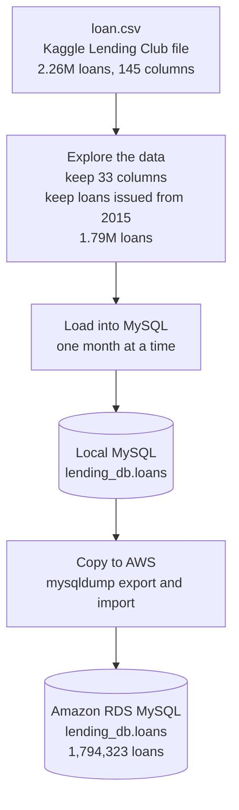
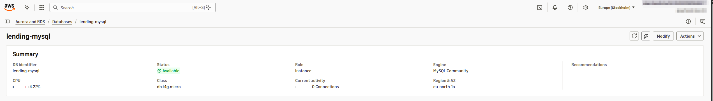
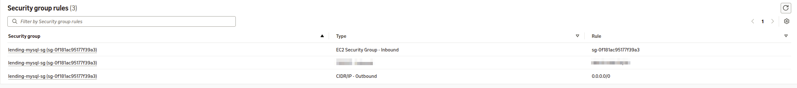
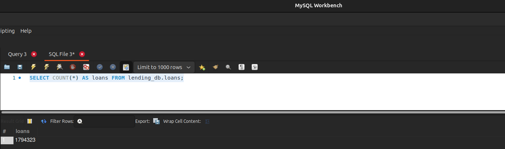
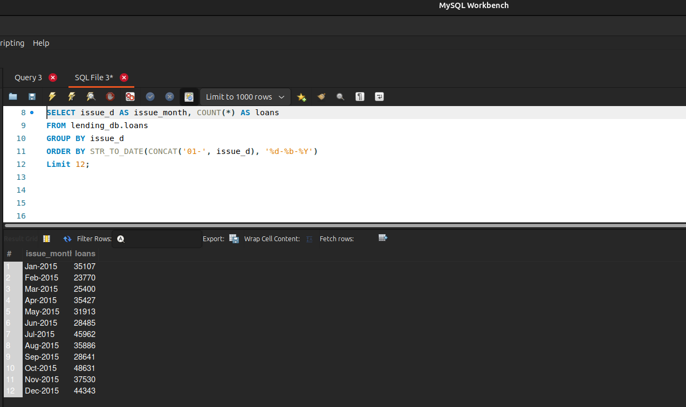

# 00 Source setup: the loan data in MySQL

This stage prepares the source system for the pipeline. The Kaggle Lending Club file is
explored, loaded into MySQL month by month, and then moved to Amazon RDS MySQL. The
pipeline reads its data from RDS, the way a real pipeline reads from a company's
live database.

**Dataset:** [Lending Club Loan Data (CSV) on Kaggle](https://www.kaggle.com/datasets/adarshsng/lending-club-loan-data-csv)

## Flow

---

### Step 1: Explore the data

**What:** Kept the 33 columns needed for the analysis and only loans issued from
January 2015 onwards.
**Why:** The full file has 145 columns and loans back to 2007. The pipeline only
needs the columns used in reporting, and a recent, consistent period.

Issue dates are stored per month (for example `Jan-2015`), so the data is handled
one month at a time from here on.

---

### Step 2: Load into MySQL month by month

**What:** `load_monthly_to_mysql.py` loads the loans into MySQL one month at a time,
oldest month first.
**Why:** The database fills up the way data arrives over time. The script remembers
the last month loaded, so it can continue where it stopped and never loads a month twice.

---

### Step 3: Move the data to Amazon RDS

**What:** Copied the table from local MySQL to Amazon RDS MySQL with `mysqldump`
(export to a file, then import into RDS).
**Why:** The pipeline reads from a managed cloud database, like a real company's
live system. RDS is reachable only from an allow-listed admin IP and from Glue
(security group rules).

*The RDS instance is Available, running MySQL 8.4 on a db.t4g.micro (Single-AZ).*

*Security group `lending-mysql-sg`: inbound access only from an allow-listed admin IP
(hidden) and from the security group itself, so Glue can reach the database.
Nothing is open to the whole internet.*

---

### Step 4: Check the copy

**What:** Counted the rows in RDS and checked the months.
**Why:** Before building anything on top, the source must match the original file.

*RDS holds 1,794,323 loans, the same as the file from 2015 onwards.*

*Loans per issue month, in calendar order (first year shown). The pipeline processes
the data one month at a time.*

---

### Step 5: Prepare a test month

**What:** Held back December 2018 in a side table (`rds_setup.sql`).
**Why:** So the extract job could be tested twice: first with no new data,
then with new loans arriving.

---

## Result

| Check | Value |
|---|---|
| Loans in `loan.csv` (all years) | 2,260,668 |
| Loans from 2015 onwards | 1,794,323 |
| Months | 48 (2015-01 to 2018-12) |
| Rows in RDS `lending_db.loans` | 1,794,323 (matches the file) |

## Files

| File | Purpose |
|---|---|
| `load_monthly_to_mysql.py` | Loads the loans into MySQL one month at a time |
| `rds_setup.sql` | Copy check, hold back and release December 2018 |

`loan.csv` (about 1.2 GB) is not stored in this repository. Download it from
[Kaggle](https://www.kaggle.com/datasets/adarshsng/lending-club-loan-data-csv).
The `.env` file with passwords is not stored here either.