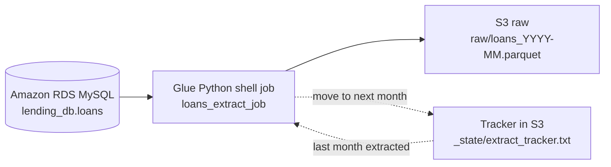
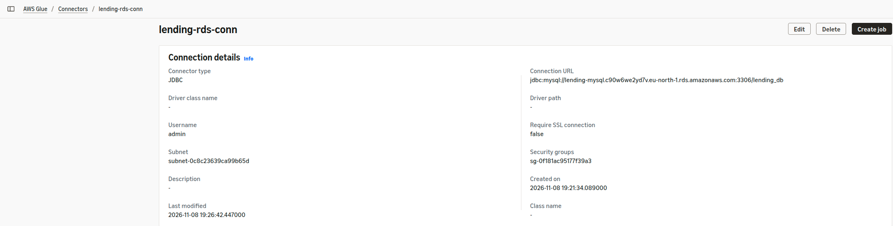
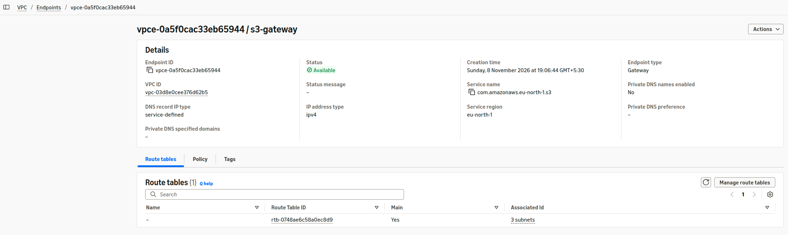
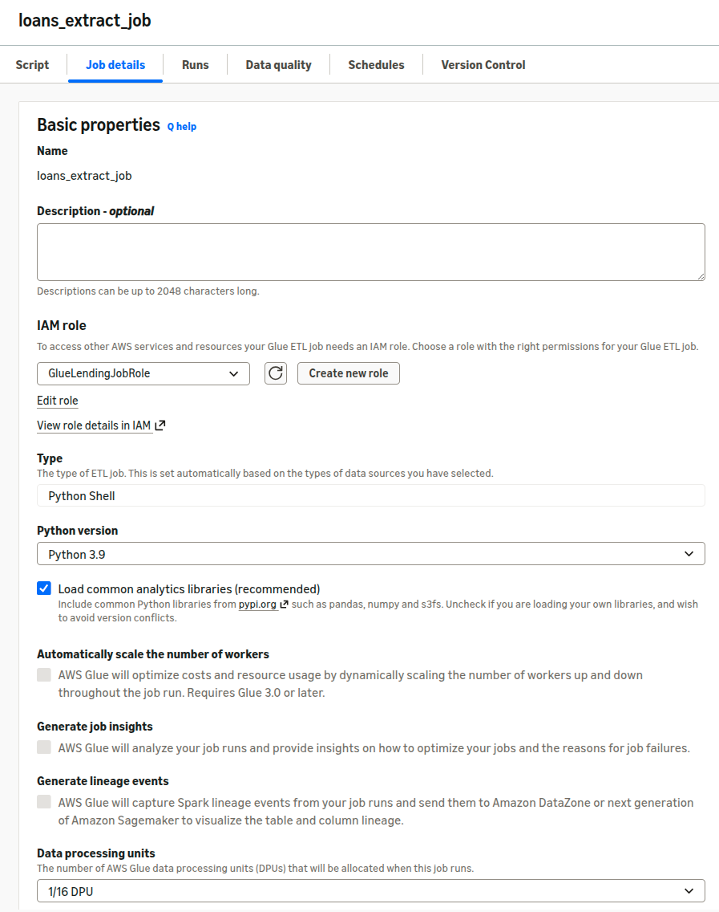
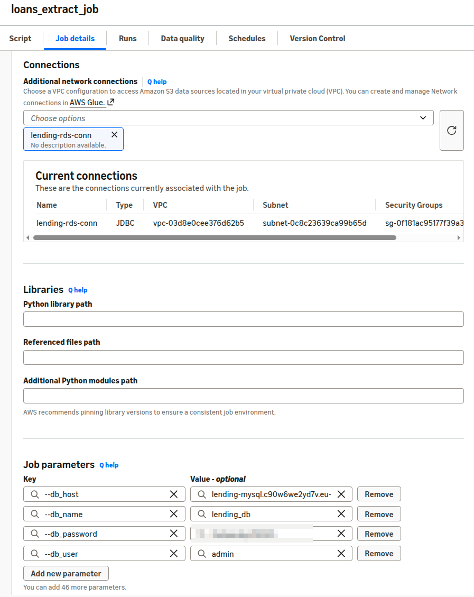
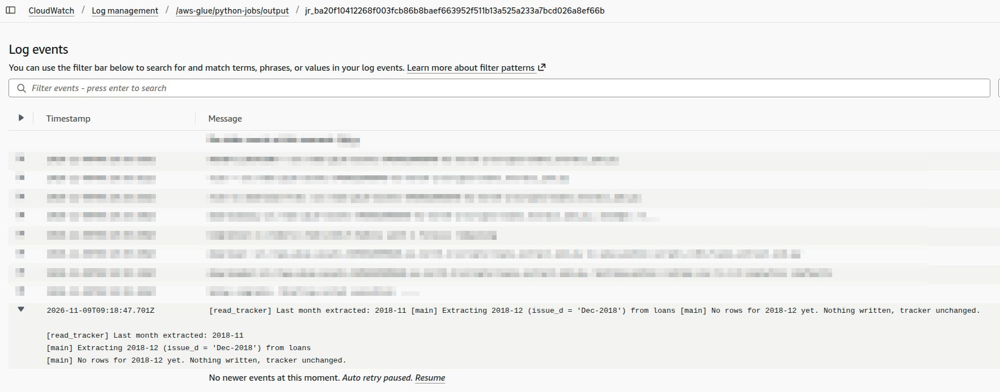
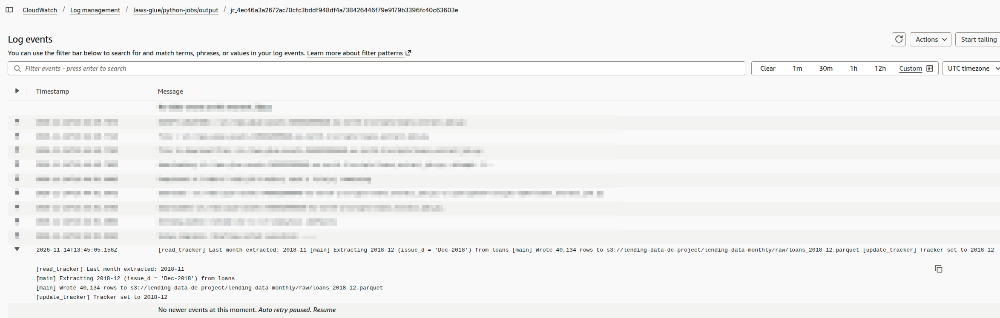
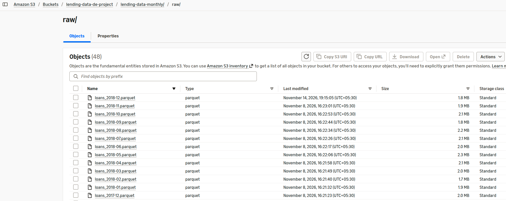

# 01 Ingestion: from the source database to S3 raw (Bronze)

This stage moves the loans from the source database into the raw (Bronze) layer in S3.
A Glue job runs inside AWS, finds the next month that has not been extracted yet,
reads it from RDS MySQL and saves it in S3 as a Parquet file.

## Flow

---

### Step 1: Give Glue a private route to RDS

**What:** A Glue JDBC connection, `lending-rds-conn`, with the VPC, subnet and
security group of the database.
**Why:** Glue jobs that use this connection run inside the same private network as
RDS, so the database never has to be opened to the internet.

The security group `lending-mysql-sg` allows port 3306 only from an allow-listed
admin IP, plus a self-referencing rule so Glue can reach RDS.

*The JDBC connection to `lending_db`, set to run in the database's VPC subnet and
security group.*

---

### Step 2: Give Glue a private route to S3

**What:** An S3 gateway endpoint in the VPC.
**Why:** Jobs inside the VPC have no internet access. The gateway endpoint gives
them a private route to S3, free of charge, without a NAT gateway.

*Gateway endpoint for `com.amazonaws.eu-north-1.s3`, attached to the subnet's route table.*

---

### Step 3: Build the extract job

**What:** `loans_extract_job.py`, a Glue Python shell job.
**How it works:**
1. Read the last extracted month from the tracker in S3.
2. Work out the next month and query it from RDS.
3. Write the rows as one Parquet file to `raw/loans_YYYY-MM.parquet`.
4. Move the tracker forward, only after the write succeeded.

If the month has no rows yet, nothing is written and the tracker is not changed.

*A small Python shell job: 1/16 DPU and a 10 minute timeout.*

*The job runs through `lending-rds-conn`. The database login comes from job
parameters (password hidden), not from the code.*

---

### Step 4: Test with no new data

**What:** December 2018 was held back in RDS, then the job was run.
**Why:** The job must not fail or write an empty file when nothing new has arrived.

*No rows for the next month: nothing written, tracker unchanged.*

---

### Step 5: Test a new month arriving

**What:** December 2018 was released in RDS, then the job was run again.
**Why:** This is the normal monthly case.

*The job found December, wrote 40,134 loans to raw, then moved the tracker to 2018-12.*

*The raw layer: one Parquet file per month, 48 months in total.*

---

## Test results

| Run | Situation | Result |
|---|---|---|
| 1 | December 2018 not in RDS yet | No rows, nothing written, tracker stayed at 2018-11 |
| 2 | December 2018 added to RDS | 40,134 rows written to `raw/loans_2018-12.parquet`, tracker moved to 2018-12 |

## Glue job settings

| Setting | Value |
|---|---|
| Type | Python shell, Python 3.9, analytics libraries |
| Capacity | 1/16 DPU, 10 minute timeout |
| Connection | `lending-rds-conn` |
| Job parameters | `--db_host`, `--db_name`, `--db_user`, `--db_password` |

The password is only stored in the Glue job parameters, not in this repository.
In production it would live in AWS Secrets Manager.

## Problems solved

| Problem | Cause | Fix |
|---|---|---|
| Glue connection failed: VPC has no access to STS | Newer connection type checks itself from inside the VPC | Used a plain JDBC connection instead |
| Test connection: no S3 endpoint for subnet | Subnet used the main route table implicitly | Linked the subnet to the route table explicitly |
| Job failed with exit code 2 | `--db_password` parameter missing | Added the job parameter |
| Job failed with NoSuchKey | Tracker file not in S3 yet | Uploaded `_state/extract_tracker.txt` |

## Files

| File | Purpose |
|---|---|
| `loans_extract_job.py` | Glue job: next month from RDS to S3 raw |

## Cost notes

- RDS (db.t4g.micro) is stopped or deleted when not in use, with a snapshot to restore from.
- The S3 gateway endpoint is free. Interface endpoints (STS, Secrets Manager) were
  avoided because they charge per hour.