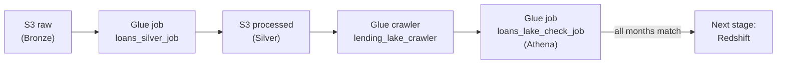
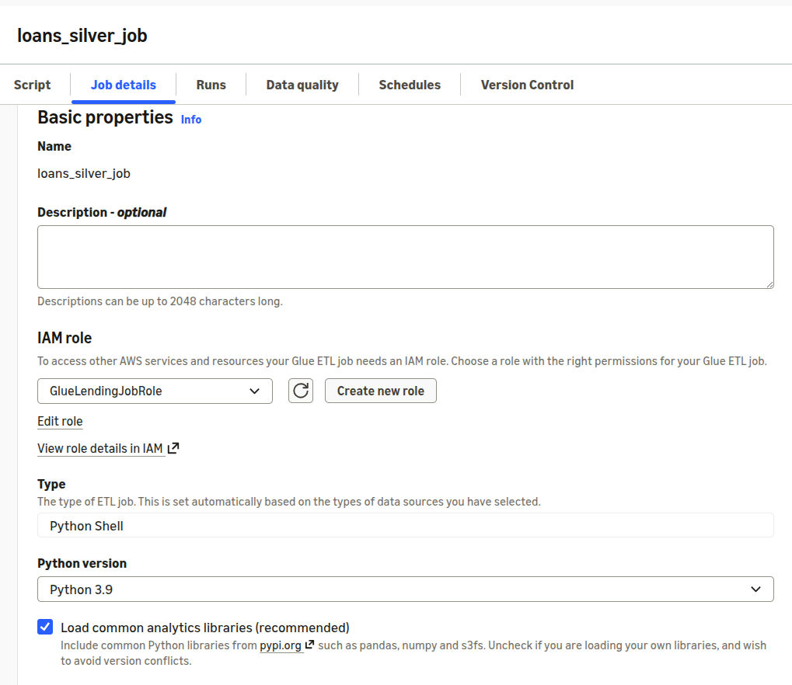
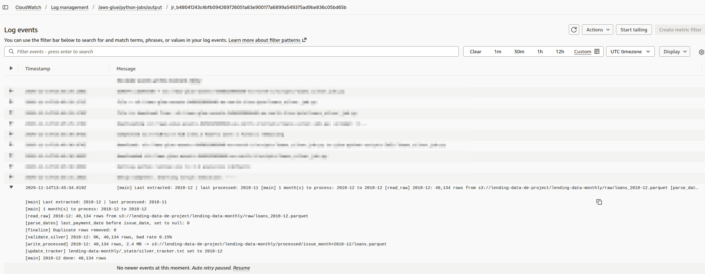
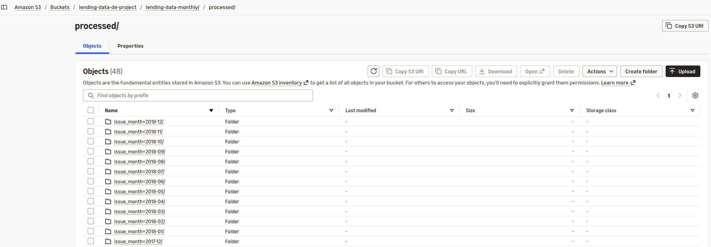
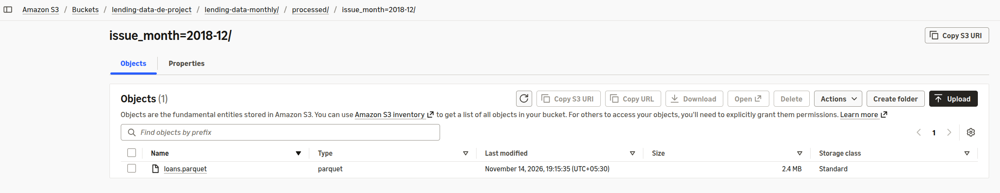
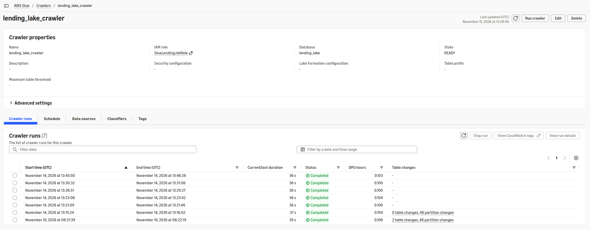
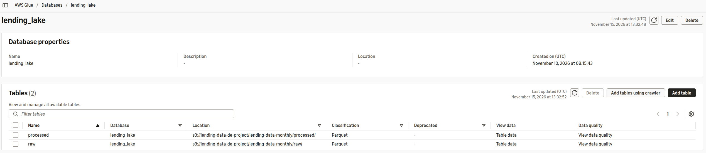
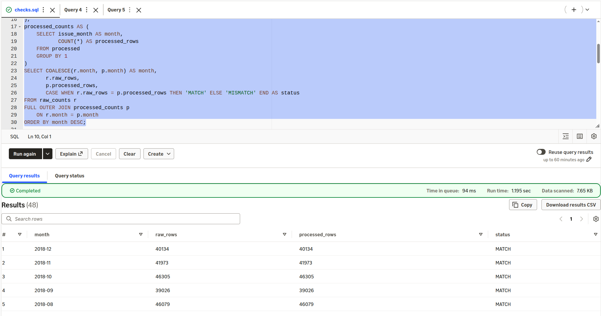
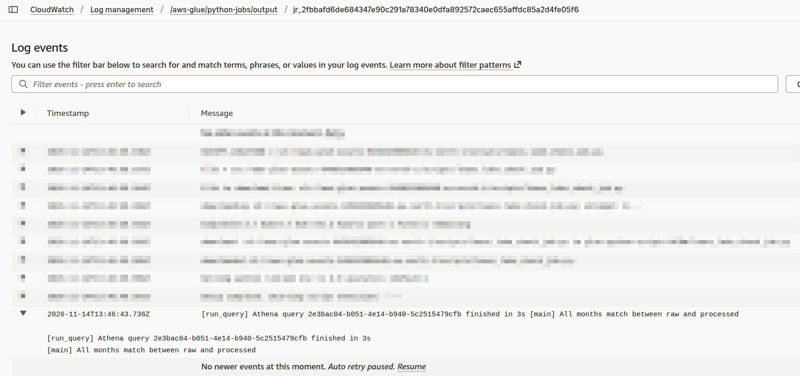

# 02 Transformation: from S3 raw to S3 processed (Silver)

This stage cleans each new month of raw loans, saves it in S3 as typed Parquet
(one folder per issue month), and then checks in Athena that every month in raw
arrived in processed before anything is loaded into the warehouse.

## Flow

---

### Step 1: Build the Silver job

**What:** `loans_silver_job.py`, a Glue Python shell job that turns one month of
raw loans into clean, typed Silver data.
**How it works:**
1. Renames columns to readable names (for example `loan_amnt` to `loan_amount`).
2. Converts dates (`Jan-2015`) and numbers (removes `%` signs).
3. Standardises text casing, employment length and home ownership.
4. Replaces placeholder values (debt-to-income `-1` and `999`) with blanks.
5. Adds `issue_month`, `issue_year`, `loan_status_category`, `is_bad`, data quality flags and a `loan_key`.
6. Checks 7 rules (row counts, dates, grades, terms, unique keys) and stops if one fails.

The job finds its own work: it reads the extract tracker and its own tracker in
`_state/`, and processes every month in between. A missed run is caught up automatically.

*A small Python shell job. No connection and no parameters: it finds its months from the trackers.*

---

### Step 2: Process a new month

**What:** The job read December 2018 from raw, cleaned it, checked it and wrote it
to its own folder in processed.

*40,134 rows in, 40,134 rows out. All 7 checks passed, and the tracker moved to 2018-12
only after the file was written.*

*The Silver layer: one folder per month, named `issue_month=YYYY-MM`.*

*Each month folder holds one Parquet file.*

The `issue_month=` folder names are partitions: Athena and Redshift can read a
single month without scanning the whole dataset.

---

### Step 3: Register the lake tables

**What:** A Glue crawler scans `raw/` and `processed/` and creates two tables in
the `lending_lake` database. Each run registers any new month as a partition.
**Why:** So the lake can be queried with SQL in Athena.

*The crawler's first run created both tables and registered 48 monthly partitions.
Later runs only add new months.*

*Two tables, `raw` (Bronze) and `processed` (Silver), each pointing at its S3 folder.*

---

### Step 4: Check that every month arrived

**What:** An Athena query compares the number of loans per month in raw and in
processed.
**Why:** The Silver job checks the one month it just wrote. This check looks at
every month from the outside, so it also catches a month that was never processed
or a partition that was not registered.

*Every month has the same number of loans in raw and processed.*

`loans_lake_check_job` runs a version of this query that returns only the months
that do not match. No rows means the pipeline continues to Redshift. Any rows stop
it, so nothing incomplete reaches the warehouse.

*The automated check: all months match, so the next stage can run.*

All lake queries are in `sql/athena/checks.sql`.

---

## Test results

| Situation | Result |
|---|---|
| December 2018 in raw, Silver tracker at 2018-11 | 40,134 rows processed, all checks passed, tracker moved to 2018-12 |
| Athena check after Silver | All 48 months match between raw and processed (1,794,323 loans) |

## Files

| File | Purpose |
|---|---|
| `loans_silver_job.py` | Glue job: raw Parquet to Silver Parquet |
| `loans_lake_check_job.py` | Glue job: Athena check that every month matches between raw and processed |