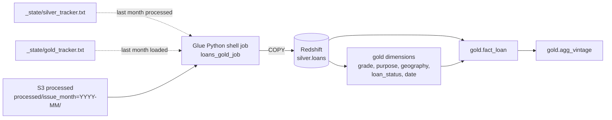

# 03 Warehouse: from S3 processed to Redshift (Silver and Gold)

This stage loads each new month of cleaned loans into Amazon Redshift Serverless
and updates the Gold star schema that Power BI reads. Only the new month is
loaded. Existing rows and existing dimension IDs are never changed.

## Flow

## Gold star schema

| Table | Grain | Key |
|---|---|---|
| `gold.fact_loan` | one row per loan | `loan_key`, plus the four dimension IDs |
| `gold.dim_grade` | one row per grade and sub-grade (A1 to G5) | `grade_id` (IDENTITY) |
| `gold.dim_purpose` | one row per loan purpose | `purpose_id` (IDENTITY) |
| `gold.dim_geography` | one row per borrower state | `geography_id` (IDENTITY) |
| `gold.dim_loan_status` | one row per loan status, with category and `is_bad` | `status_id` (IDENTITY) |
| `gold.dim_date` | one row per month | `month_start` |
| `gold.agg_vintage` | one row per issue month and grade | `issue_month`, `grade` |

`fact_loan` is sorted by `issue_date`, so date filters (reports, and the monthly
delete of one month) only read the blocks for that month.

## What the job does for each new month

All steps for one month run in **one transaction**: either every step succeeds,
or nothing is kept.

1. **silver.loans**: delete the month, then `COPY` it from `processed/issue_month=YYYY-MM/`.
2. **Dimensions**: insert only values not seen before (`NOT IN` the dimension).
   The IDENTITY columns give new values the next ID, so existing IDs never change.
3. **fact_loan**: delete the month, then insert it with the dimension IDs.
4. **agg_vintage**: delete the month, then recalculate it from the fact table.

Then the job checks the month and stops if any check fails:

| Check | Expected |
|---|---|
| Rows in `silver.loans` for the month | more than 0 |
| Rows in `fact_loan` for the month | equal to Silver |
| Fact rows with a missing dimension ID | 0 |
| Loans counted in `agg_vintage` for the month | equal to the fact table |

The Gold tracker moves forward only after the checks pass. Deleting each month
before inserting it makes a re-run safe: a month is never loaded twice.

SQL is sent with the Redshift Data API, so the job needs no database driver,
no VPC connection and no password in the code. It logs in with the Redshift
admin secret in AWS Secrets Manager.

## Test results

| Situation | Result |
|---|---|
| December 2018 loaded by the job on its own | 40,134 rows in Silver, fact and aggregate, no missing IDs, tracker moved to 2018-12 |
| December 2018 loaded through the Airflow pipeline | Same result, `fact_loan` total unchanged at 1,794,323 (the month was replaced, not added twice) |

## Glue job settings

| Setting | Value |
|---|---|
| Type | Python shell, Python 3.9, analytics libraries, 1/16 DPU |
| Timeout | 15 minutes |
| Connection | none (the Redshift Data API is reached over AWS endpoints) |
| Job parameters | `--workgroup_name`, `--database`, `--secret_arn`, `--additional-python-modules boto3==1.34.162` |

## Problems solved

| Problem | Cause | Fix |
|---|---|---|
| Dimension IDs could shift when a new value appeared | IDs were made with `ROW_NUMBER()` on every rebuild | Moved the four ID dimensions to IDENTITY columns and load only new values |
| `Unknown parameter in input: "WorkgroupName"` | Glue Python shell ships an old boto3 that predates Redshift Serverless | Installed a pinned newer version with `--additional-python-modules` |
| Redshift COPY failed with a Spectrum Scan Error | `issue_year` was int32 in older files and int64 in the new one | Set the type explicitly in the Silver job |
| Query editor login failed after enabling Secrets Manager | AWS replaced the admin password with a managed one | Connected the query editor through the secret |

## Files

| File | Purpose |
|---|---|
| `loans_gold_job.py` | Glue job: new months from S3 processed into Redshift Silver and Gold |

The table definitions are in `sql/redshift/` (01 Silver, 02 dimensions, 03 fact, 04 aggregate).