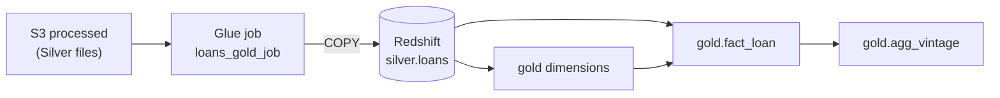
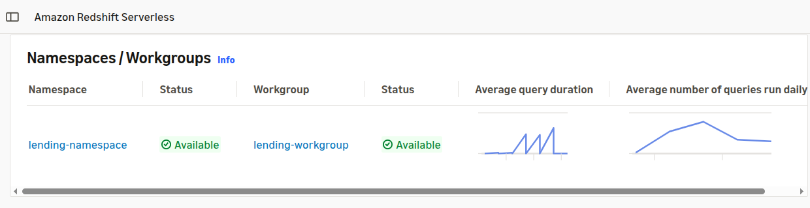
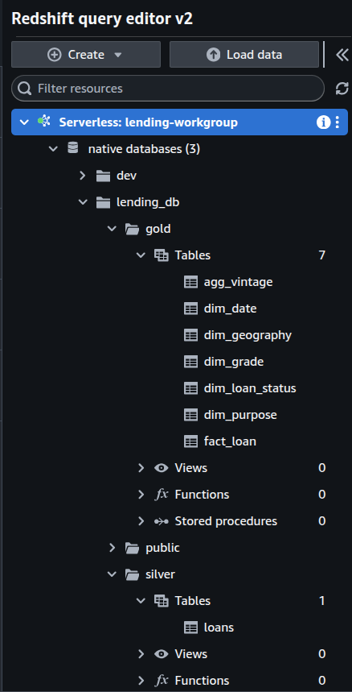
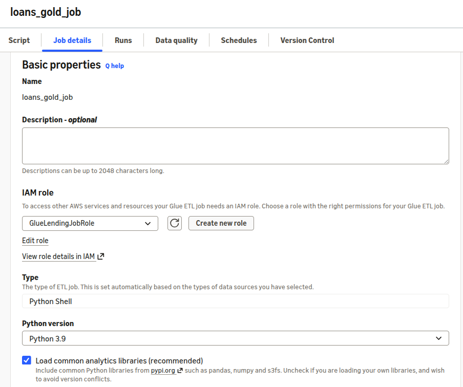
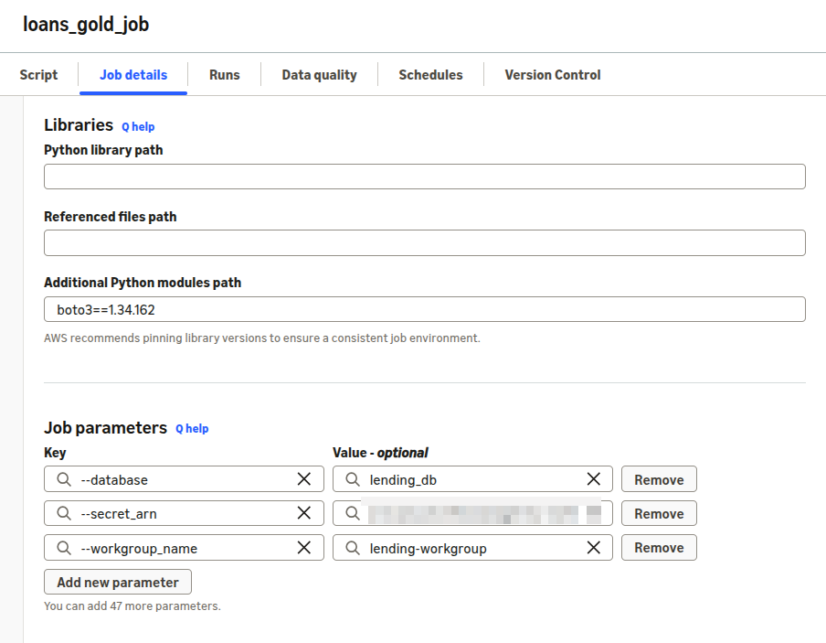
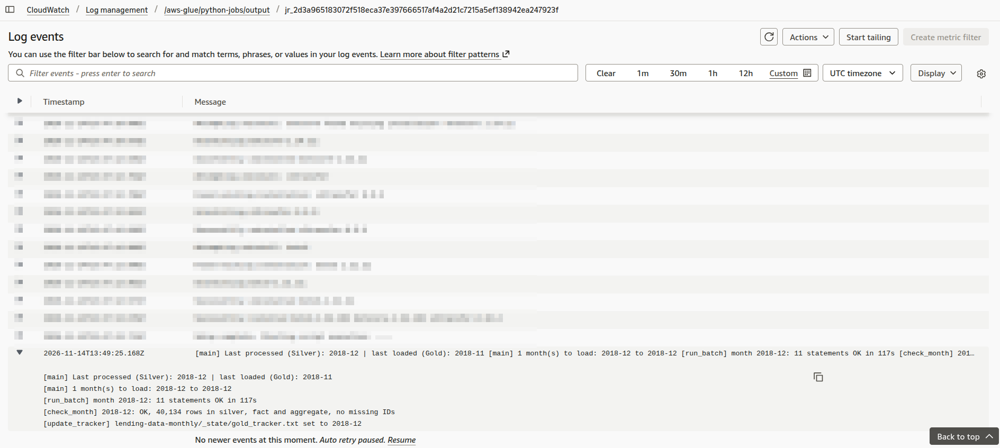
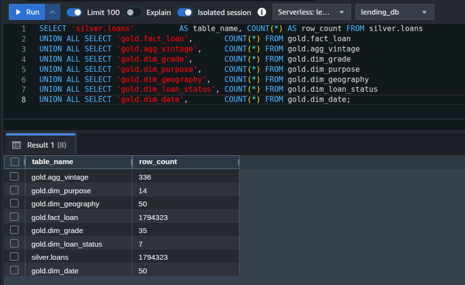
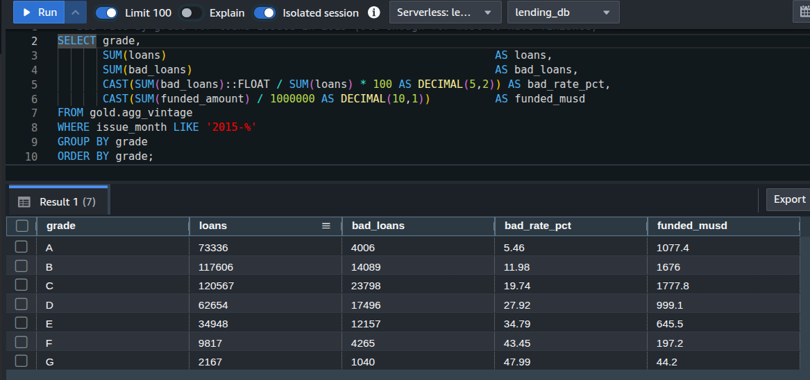

# 03 Warehouse: from S3 processed to Redshift (Silver and Gold)

This stage loads each new month of cleaned loans into Amazon Redshift Serverless
and updates the Gold star schema that the dashboard reads. Only the new month is
loaded. Existing rows and existing dimension IDs are never changed.

## Flow

---

### Step 1: The warehouse

**What:** Amazon Redshift Serverless, database `lending_db`, with two schemas:
`silver` (the cleaned loans) and `gold` (the star schema for reporting).
**Why:** Serverless scales by itself and only charges while queries run, with no
cluster to size or manage.

*The Redshift Serverless workgroup the pipeline loads into.*

---

### Step 2: Design the Gold star schema

| Table | Grain | Key |
|---|---|---|
| `gold.fact_loan` | one row per loan | `loan_key`, plus the four dimension IDs |
| `gold.dim_grade` | one row per grade and sub-grade (A1 to G5) | `grade_id` (IDENTITY) |
| `gold.dim_purpose` | one row per loan purpose | `purpose_id` (IDENTITY) |
| `gold.dim_geography` | one row per borrower state | `geography_id` (IDENTITY) |
| `gold.dim_loan_status` | one row per loan status, with category and `is_bad` | `status_id` (IDENTITY) |
| `gold.dim_date` | one row per month | `month_start` |
| `gold.agg_vintage` | one row per issue month and grade | `issue_month`, `grade` |

The dimension IDs are IDENTITY columns: Redshift gives each new value the next ID,
and existing IDs never change. `fact_loan` is sorted by `issue_date`, so date
filters only read the blocks for the months they need.

*The `silver` and `gold` schemas: one fact table, five dimensions and one aggregate.*

The table definitions are in `sql/redshift/` (01 Silver, 02 dimensions, 03 fact, 04 aggregate).

---

### Step 3: Build the Gold job

**What:** `loans_gold_job.py`, a Glue Python shell job. For each new month it runs,
in **one transaction** (every step succeeds, or nothing is kept):

1. **silver.loans**: delete the month, then `COPY` it from `processed/issue_month=YYYY-MM/`.
2. **Dimensions**: insert only values not seen before.
3. **fact_loan**: delete the month, then insert it with the dimension IDs.
4. **agg_vintage**: delete the month, then recalculate it.

Then it checks the month and stops if any check fails:

| Check | Expected |
|---|---|
| Rows in `silver.loans` for the month | more than 0 |
| Rows in `fact_loan` for the month | equal to Silver |
| Fact rows with a missing dimension ID | 0 |
| Loans counted in `agg_vintage` for the month | equal to the fact table |

Deleting each month before inserting it makes a re-run safe: a month is never
loaded twice. SQL is sent with the Redshift Data API, so the job needs no
database driver, no VPC connection and no password in the code. It logs in with
the Redshift admin secret in AWS Secrets Manager.

*A small Python shell job with no VPC connection.*

*The job only receives the workgroup, the database and a pointer to the secret.
A newer boto3 is installed at start-up for the Redshift Serverless Data API.*

---

### Step 4: Load a new month

**What:** The job loaded December 2018 from S3 processed into Silver and Gold.

*All 11 statements ran as one transaction. December is complete in Silver, the fact
table and the aggregate, with no missing dimension IDs. Only then did the tracker move.*

*Every Silver loan reached the fact table (1,794,323 in both). The dimensions are
small lookup tables.*

---

### Step 5: Check Gold is ready for reporting

**What:** A test query on `gold.agg_vintage`: bad rate by grade for loans issued in 2015.
**Why:** To confirm the Gold tables return sensible results before connecting
the dashboard. Risk should rise from grade A to grade G.

*The bad rate rises steadily from grade A to grade G, as expected for a credit grade.
The Gold layer is ready for the dashboard.*

---

## Test results

| Situation | Result |
|---|---|
| December 2018 loaded by the job on its own | 40,134 rows in Silver, fact and aggregate, no missing IDs, tracker moved to 2018-12 |
| December 2018 loaded through the Airflow pipeline | Same result, `fact_loan` total unchanged at 1,794,323 (the month was replaced, not added twice) |

## Glue job settings

| Setting | Value |
|---|---|
| Type | Python shell, Python 3.9, analytics libraries, 1/16 DPU |
| Timeout | 15 minutes |
| Connection | none (the Redshift Data API is reached over AWS endpoints) |
| Job parameters | `--workgroup_name`, `--database`, `--secret_arn`, `--additional-python-modules boto3==1.34.162` |

## Files

| File | Purpose |
|---|---|
| `loans_gold_job.py` | Glue job: new months from S3 processed into Redshift Silver and Gold |