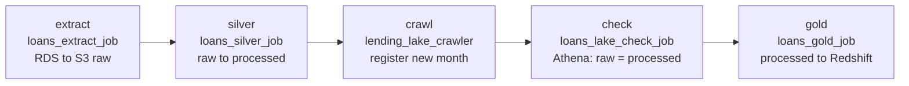

# 04 Orchestration: the monthly pipeline in Apache Airflow

One Airflow DAG, `lending_monthly_pipeline`, runs the whole pipeline once a month.
Each step starts only after the previous one succeeded, so a failure stops the
chain before anything reaches Redshift.

## The DAG



| Setting | Value | Why |
|---|---|---|
| Schedule | `0 2 1 * *` (02:00 on the 1st, India time) | One run per month, after the month has closed |
| `catchup` | False | Do not run every month since the start date |
| `max_active_runs` | 1 | Two monthly runs would move the same trackers |
| Retries | 1, after 5 minutes | Covers short AWS hiccups without hiding real failures |

Each task uses the Amazon provider operators (`GlueJobOperator`,
`GlueCrawlerOperator`) and waits until its Glue job or crawler has finished.
The jobs find their own work from the trackers in S3 (`_state/`), so the DAG
only has to start them in the right order. A month with no new data passes
through every step without loading anything.

## Run results

The December 2018 run through the full pipeline (all tasks succeeded on the first try):

| Task | Duration | Result |
|---|---|---|
| extract | 46.5 s | 40,134 rows written to `raw/loans_2018-12.parquet` |
| silver | 26.6 s | 40,134 rows cleaned and validated |
| crawl | 44.3 s | lake tables up to date |
| check | 26.8 s | all months match between raw and processed |
| gold | 2 m 38 s | 40,134 rows in Silver, fact and aggregate, no missing IDs |
| **Total** | **5 m 5 s** | |

## AWS access

Airflow uses one IAM user, `airflow-orchestrator`, stored as the Airflow
connection `aws_default`. Its policy only allows starting and checking the four
Glue jobs and the crawler, each named by its ARN. It cannot read data, change
jobs or create resources. No keys are stored in this repository.

## Production setup

In production the same DAG file runs on Amazon MWAA (managed Airflow), with
AWS access from the MWAA execution role instead of an access key, and the
Fernet key and connections kept in AWS Secrets Manager.

## How to run it locally

For this build Airflow ran in Docker with the official docker-compose setup
(Airflow 3.4.0). The same DAG runs on MWAA without changes.

```bash
cd 04_orchestration
mkdir -p ./dags ./logs ./plugins ./config
echo -e "AIRFLOW_UID=$(id -u)" > .env
docker compose up airflow-init     # first time only
docker compose up -d               # start Airflow
```

Open http://localhost:8080, add the `aws_default` connection
(Amazon Web Services, region `eu-north-1`), switch the DAG on and trigger it.

## Problems solved

| Problem | Cause | Fix |
|---|---|---|
| Crawl task failed: not authorized to perform `glue:GetCrawlerMetrics` | This action does not support resource-level permissions, so a statement limited to the crawler ARN never matches | Gave `GetCrawlerMetrics` its own statement with `Resource: "*"` (read-only) |
| Extract task failed: `SyntaxError` at line 54 | A pasted comment block left an extra `"""` in the Glue script | Replaced the script with a clean version and checked it compiles |
| `permission denied` on the Docker socket | The terminal was opened before the user was added to the `docker` group | `newgrp docker`, or log out and back in |
| `FERNET_KEY variable is not set` warning | No key to encrypt stored connections | Generated a key into `.env` (git-ignored) |

## Files

| File | Purpose |
|---|---|
| `dags/lending_monthly_pipeline.py` | The DAG: five tasks and their order |
| `docker-compose.yaml` | Official Airflow 3.4.0 Docker setup (example DAGs switched off) |

`.env`, `logs/`, `config/` and `plugins/` are local Airflow files and are not stored here.