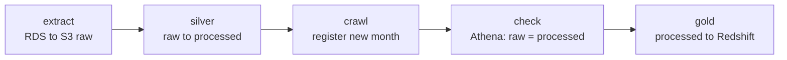
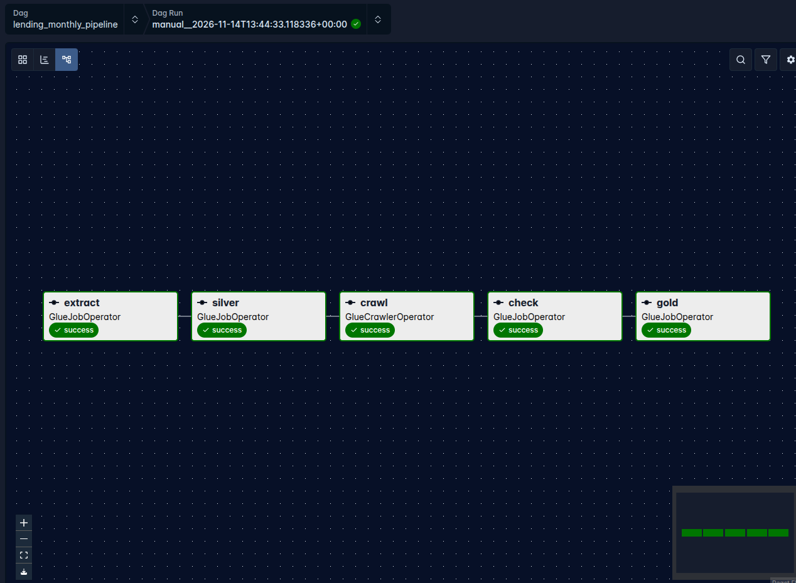
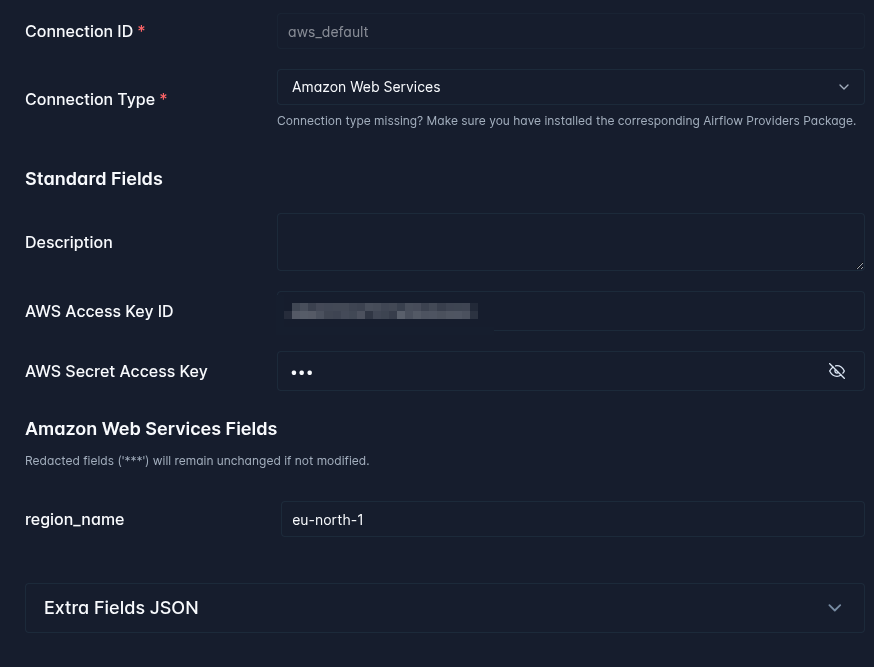
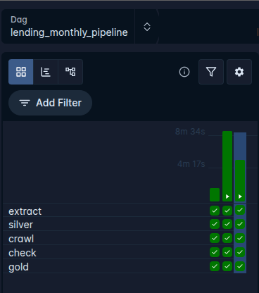
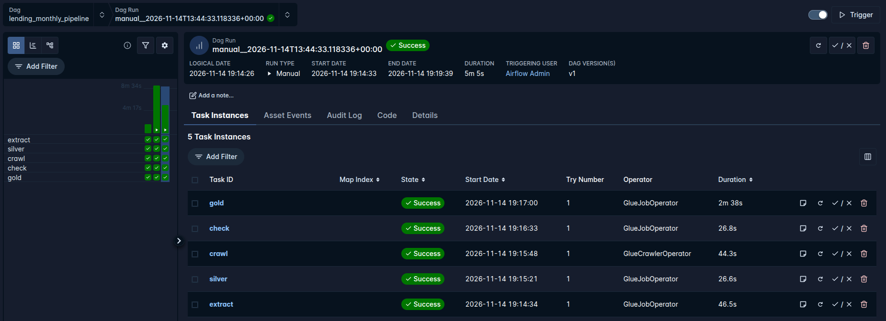

# 04 Orchestration: the monthly pipeline in Apache Airflow

One Airflow DAG, `lending_monthly_pipeline`, runs the whole pipeline once a month.
Each step starts only after the previous one succeeds, so a failure stops the
chain before anything reaches Redshift.

## Flow



---

### Step 1: Build the DAG

**What:** `dags/lending_monthly_pipeline.py`, a DAG with five tasks that start
the four Glue jobs and the crawler in order.

**Why:** Each stage depends on the one before it. Airflow runs them in the right
order, waits for each to finish, retries short failures and stops the chain if a
step fails.

**How it works:**
1. `GlueJobOperator` starts a Glue job and waits until it has finished.
2. `GlueCrawlerOperator` runs `lending_lake_crawler` so Athena sees the new month.
3. The order is set in one line: `extract >> silver >> crawl >> check >> gold`.
4. The jobs find their own work from the trackers in S3 (`_state/`), so the DAG
   only has to start them. A month with no new data passes through every step
   without loading anything.

| Setting | Value | Why |
|---|---|---|
| Schedule | `0 2 1 * *` (02:00 on the 1st, India time) | One run per month, after the month has closed |
| `catchup` | False | Do not run every month since the start date |
| `max_active_runs` | 1 | Two runs at once would move the same trackers |
| Retries | 1, after 5 minutes | Covers short AWS hiccups without hiding real failures |


*The five tasks in order. Each one starts only after the previous one succeeds.*

---

### Step 2: Give Airflow access to AWS

**What:** One IAM user, `airflow-orchestrator`, stored in Airflow as the
connection `aws_default`.

**Why:** Airflow only needs to start and check the jobs. Its policy allows
starting and checking the four Glue jobs and the crawler, each named by its ARN.
It cannot read data, change jobs or create resources. No keys are stored in this
repository.


*The `aws_default` connection in Airflow, with the keys hidden.*

---

### Step 3: Run the pipeline for a new month

**What:** A full run that loaded December 2018 from the source database all the
way into the Gold tables.

**Why:** To prove the whole chain works end to end with one trigger.


*The December 2018 run, with every task green.*

| Task | Duration | Result |
|---|---|---|
| extract | 46.5 s | 40,134 rows written to `raw/loans_2018-12.parquet` |
| silver | 26.6 s | 40,134 rows cleaned and validated |
| crawl | 44.3 s | Lake tables up to date |
| check | 26.8 s | All months match between raw and processed |
| gold | 2 m 38 s | 40,134 rows in Silver, fact and aggregate, no missing IDs |
| **Total** | **5 m 5 s** | |


*Time taken by each task. The Gold load into Redshift is the longest step.*

---

## Production setup

In production the same DAG file runs on Amazon MWAA (managed Airflow), with AWS
access from the MWAA execution role instead of an access key, and the Fernet key
and connections kept in AWS Secrets Manager.

For this build Airflow ran in Docker with the official docker-compose setup
(Airflow 3.4.0). The DAG runs on MWAA without changes.

```bash
cd 04_orchestration
mkdir -p ./dags ./logs ./plugins ./config
echo "AIRFLOW_UID=$(id -u)" > .env       # add FERNET_KEY here too
docker compose up airflow-init           # first time only
docker compose up -d                     # start Airflow
```

Then add the `aws_default` connection (Amazon Web Services, region
`eu-north-1`), switch the DAG on and trigger it.

## Files

| File | Purpose |
|---|---|
| `dags/lending_monthly_pipeline.py` | The DAG: five tasks and their order |
| `docker-compose.yaml` | Official Airflow 3.4.0 Docker setup (example DAGs switched off) |

`.env`, `logs/`, `config/` and `plugins/` are local Airflow files and are not stored here.