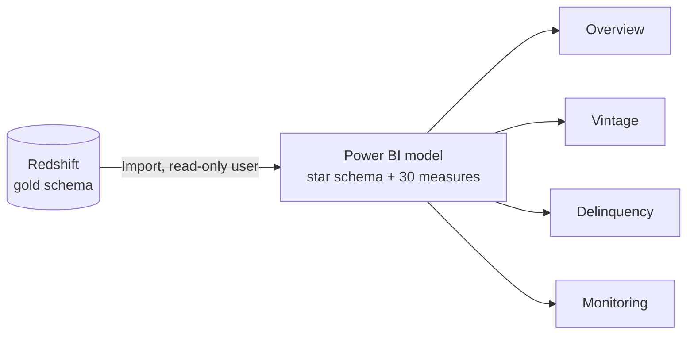
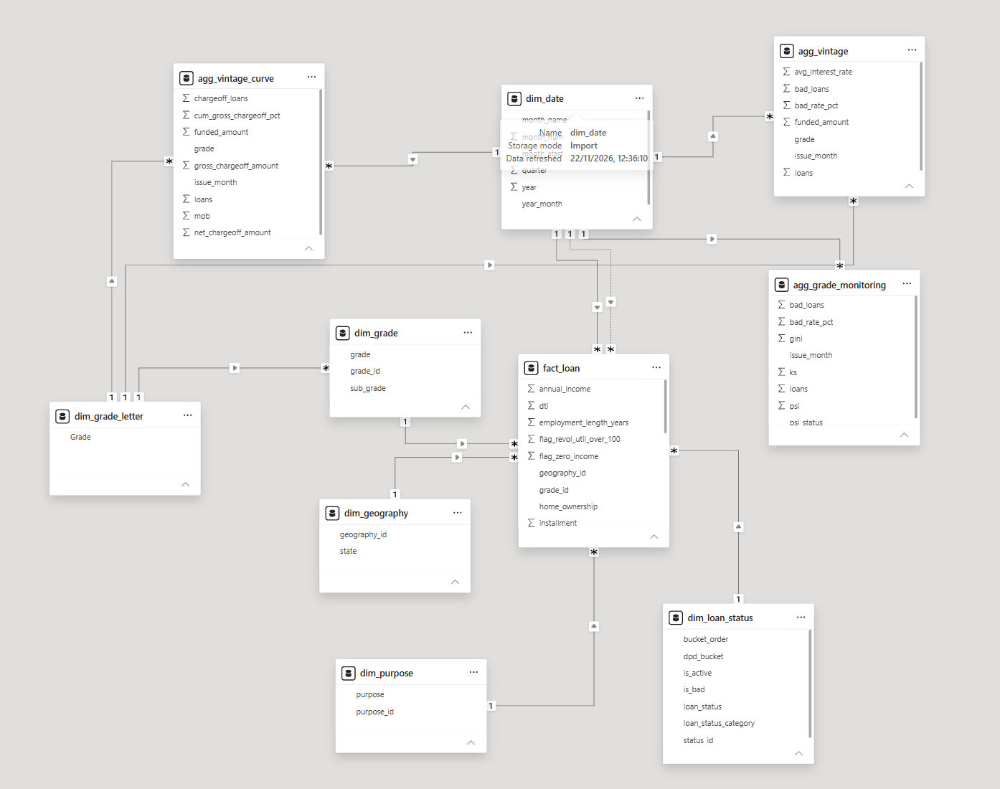
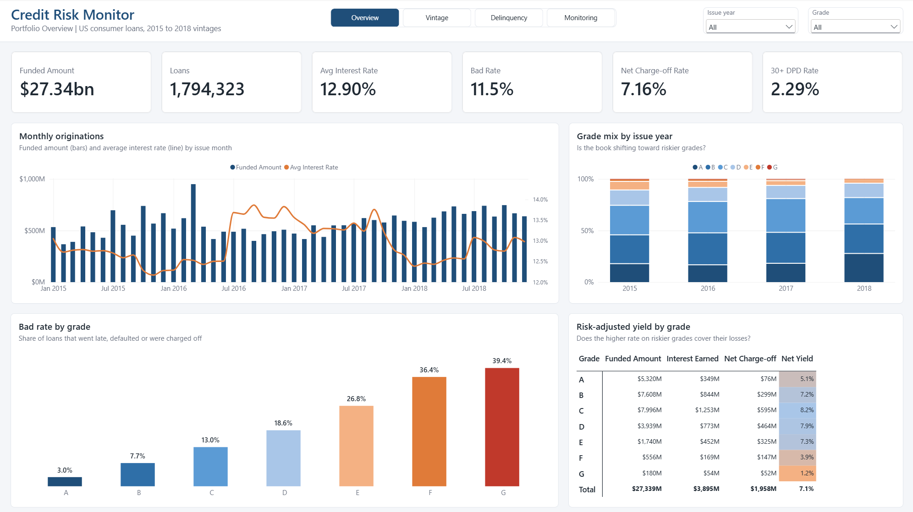
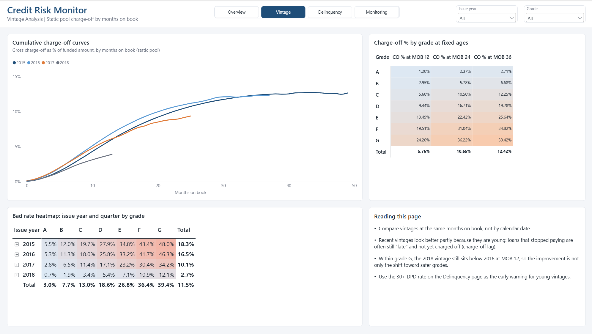
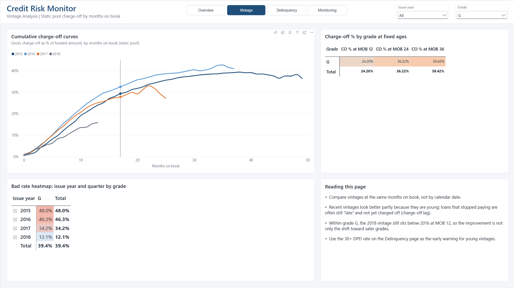
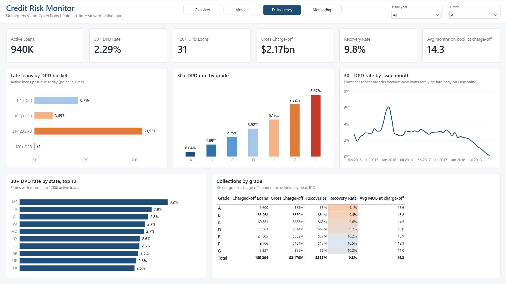
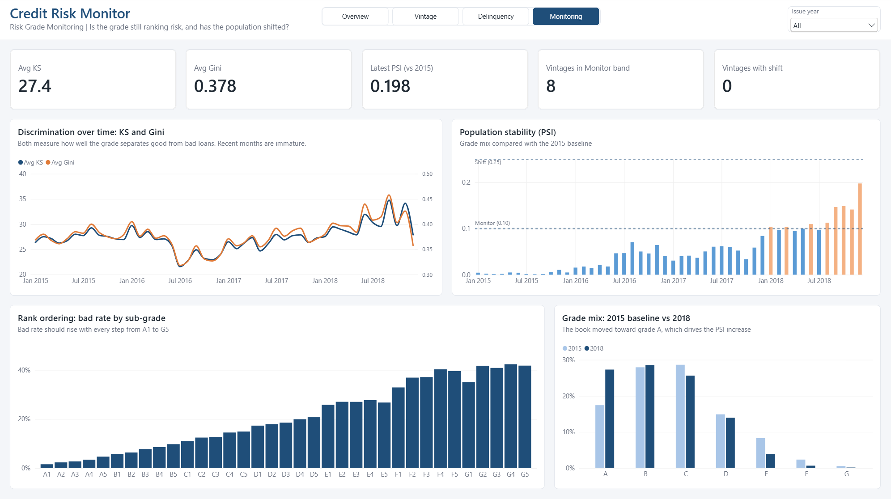

# 05 Dashboard: credit risk report in Power BI

**[View the live report](https://app.powerbi.com/view?r=eyJrIjoiOGUzYmVkYWItMDUwYi00MGM1LWFjOTItNjJhNjkxYTE5YzNkIiwidCI6ImM2ZTU0OWIzLTVmNDUtNDAzMi1hYWU5LWQ0MjQ0ZGM1YjJjNCJ9)**

This stage turns the Gold tables in Redshift into a 4-page credit risk report.
Each page answers the questions of one group of users, from portfolio size and
profitability down to delinquency, vintage losses and monitoring of the risk grade.

## Users and pages

| Page | User | Question it answers |
|---|---|---|
| Overview | Head of Credit, leadership | How big is the book, how risky is it, and does each grade pay for its risk? |
| Vintage | Credit risk analyst | Are newer loans losing more than older ones at the same age? |
| Delinquency | Collections team | How many open loans are late today, where are they, and how much is recovered? |
| Monitoring | Model monitoring analyst | Does the risk grade still rank risk, and has the population shifted? |

## Flow

---

### Step 1: Connect to the warehouse

**What:** Power BI imports the 9 Gold tables from Redshift Serverless with a
read-only user, `bi_reader`.

**Why:** The report should never hold admin credentials. `bi_reader` can only read
the `gold` schema: it cannot see Silver or change any table. Access to the
workgroup is limited to an allow-listed admin IP. Import mode keeps the report fast
and avoids paying for a Redshift query on every click.

---

### Step 2: Build the model

**What:** A star schema with `fact_loan` in the middle, 5 dimensions around it, and
3 summary tables for the vintage and monitoring pages.

**How:**
1. Relationships run one way, from each dimension to the fact table, so a slicer on
   grade, purpose, state, status or month filters the loans.
2. A second, inactive relationship links `last_payment_date` to the calendar. One
   measure switches it on with `USERELATIONSHIP` to show losses by the month they
   happened, not the month the loan was issued.
3. A 7-row table, `dim_grade_letter`, links the summary tables (which store the grade
   as a letter) so one Grade slicer filters every page.
4. All 30 measures sit in one `_Measures` table, in folders: Portfolio, Risk, Losses,
   Delinquency, Profitability, Vintage and Monitoring.

*The star schema: dimensions filter the loans, and the summary tables connect through
the calendar and the grade letter.*

**Measures used most:**

| Measure | Definition |
|---|---|
| Bad Rate | Loans late 31+ days, in default or charged off, divided by all loans |
| Net Charge-off Rate | (Principal lost on charged-off loans minus recoveries) divided by funded amount |
| 30+ DPD Rate | Active loans 31 or more days past due, divided by active loans |
| Recovery Rate | Recoveries divided by principal lost on charged-off loans |
| Net Yield | (Interest earned minus net charge-off) divided by funded amount |
| CO % at MOB 12 / 24 / 36 | Cumulative gross charge-off as % of funded amount at a fixed age |
| Avg KS, Avg Gini, Latest PSI | Monitoring of the grade, from the Gold monitoring table |

---

### Step 3: Overview

**What:** Size, risk and profitability of the whole book.

*1.79M loans and $27.3bn funded. The bad rate rises from 3.0% for grade A to 39.4% for
grade G, so the grade ranks risk as it should.*

**Findings:**
- Net yield peaks at grade C (8.2%) and falls to 3.9% for F and 1.2% for G: the riskiest
  grades do not earn enough interest to cover their losses.
- Between 2015 and 2018 the book moved toward grade A and away from grades E to G.

---

### Step 4: Vintage (static pool)

**What:** Cumulative charge-off by months on book, one line per issue year, with
charge-off at fixed ages by grade.

*Comparing vintages at the same age. By month 36, grade A lost 2.7% of funded
principal and grade G lost 39.4%.*

*The same page filtered to grade G. Every chart responds to the slicers.*

**Findings:**
- Recent vintages sit lower at the same age, even within one grade. Part of this is a
  real improvement, and part is charge-off lag: loans that recently stopped paying are
  still late and not yet charged off.

---

### Step 5: Delinquency and collections

**What:** A point-in-time view of the open book: DPD buckets, late rates by grade,
month and state, and recoveries by grade.

*940K active loans with a 30+ DPD rate of 2.29%, rising from 0.64% for grade A to 8.67%
for grade G.*

**Findings:**
- Riskier grades charge off sooner: about 15.6 months on book for grade A against 12.9
  for grade F.
- Recovery rates stay near 10% for every grade ($212M recovered on $2.17bn lost), so
  collections cannot make up for the extra risk of the lower grades.
- The late rate falls for the most recent months because new loans rarely go late in
  their first months (seasoning).

---

### Step 6: Monitoring of the risk grade

**What:** The lender's grade treated as a production credit model: discrimination
(KS, Gini), rank ordering across the 35 sub-grades, and population stability (PSI)
against a 2015 baseline.

*KS averaged 27.4 and Gini 0.378, and the bad rate rises with every sub-grade from A1
to G5. PSI reached 0.198 in 2018, with 8 vintages in the Monitor band.*

**Findings:**
- The grade kept its ability to rank risk throughout.
- The PSI increase comes from the shift toward grade A, which points to a deliberate
  tightening of approvals rather than a worse population.

---

## Data notes

- The data is a snapshot: each loan has its status on the snapshot date, not a monthly
  history. Roll rates between DPD buckets need monthly snapshots.
- The month a loan charged off is taken from its last payment date.
- The calendar is monthly, to match the vintage grain. The report needs no daily time
  intelligence.

## Production setup

In production the report is published to the Power BI Service and refreshed on a
schedule after the monthly Airflow run, so each new month appears in every page
without changes to the report.

## Files

| File | Purpose |
|---|---|
| `credit_risk_monitoring.pbip` | Power BI project (open this in Power BI Desktop) |
| `credit_risk_monitoring.SemanticModel/` | The model: tables, relationships and measures, as text files |
| `credit_risk_monitoring.Report/` | The 4 report pages, as text files |
| `clean_navy_theme.json` | Report theme |
| `images/` | Screenshots used in this README |