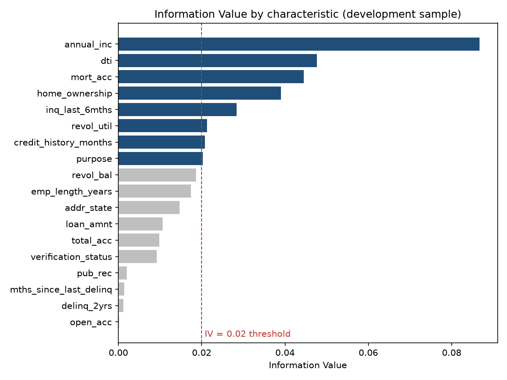
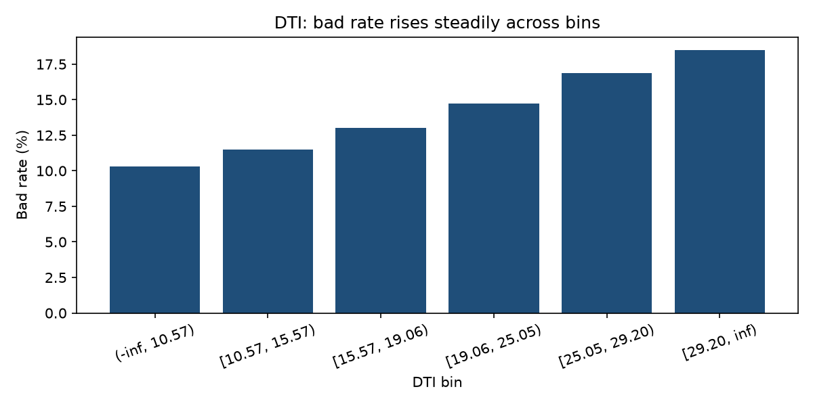
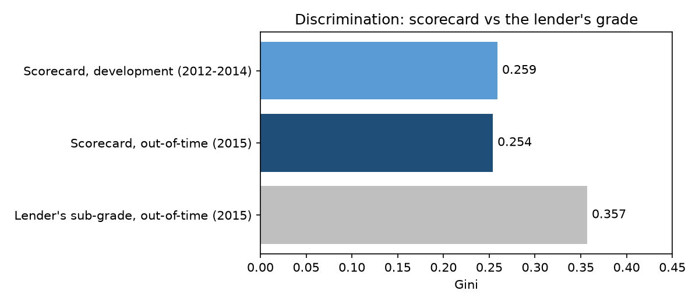
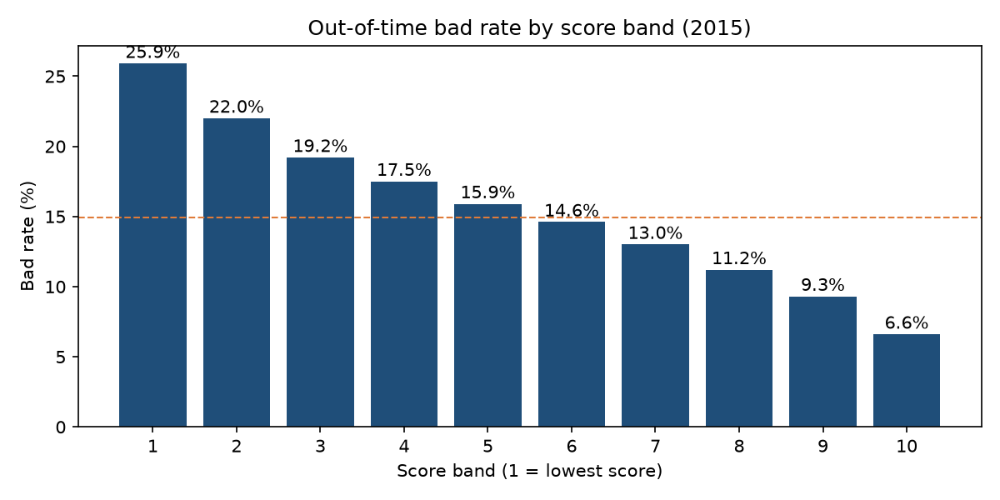
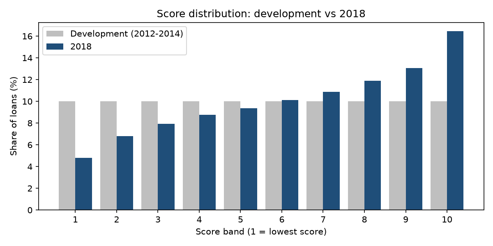

# 06 Scorecard: application credit scorecard

This stage builds an application scorecard from information available on the
application date, validates it on later loans, and compares it with the lender's own
risk grade. The Monitoring page of the dashboard checks whether the lender's grade
still works. This stage asks whether an independent score can rank the same risk.

## Business question

**Using only the application and the credit report at application, can we build a score
that ranks applicants by risk, and what cut-off would it support?**

## Design

| Item | Choice | Why |
|---|---|---|
| Population | 36-month unsecured personal loans | Their outcome is final once the term ends |
| Development | Loans issued 2012 to 2014 (306,462 loans, 13.2% bad) | All matured before the snapshot date |
| Out-of-time test | Loans issued 2015 (283,031 loans, 14.9% bad) | Shows how the score performs on later loans |
| Stability check | Loans issued 2016 to 2018 | Score distribution only, so outcomes are not needed |
| Bad | Charged off, default, or 31+ days past due | |
| Good | Fully paid | |
| Excluded | Loans still running (142 loans) | Outcome not known yet |

The lender's grade, sub-grade, interest rate and installment are left out of the model,
because they encode the lender's own decision. Every field recorded after origination
(payments, recoveries, last payment and last credit pull dates) is left out to avoid
leakage. The sub-grade is used only as the benchmark.

---

### Step 1: Select characteristics with Information Value

**What:** 18 application characteristics were grouped into at most 6 bins each, with at
least 5% of loans per bin. Each bin gets a Weight of Evidence, and each characteristic an
Information Value (IV). The 8 characteristics with IV of at least 0.02 were kept.

*Income, DTI, mortgage accounts, home ownership, recent inquiries, revolving utilisation,
credit history length and loan purpose pass the threshold.*

*An example characteristic: the bad rate rises steadily from about 10% to 18.5% as DTI
increases.*

Past-delinquency characteristics had almost no IV. The lender had already screened out
most applicants with recent delinquencies, so approved borrowers look alike on them.

---

### Step 2: Fit the model and check it

**What:** a logistic regression on the WoE values of the 8 characteristics.

**Checks passed:** all coefficients share the same sign, so every characteristic moves risk
in the intended direction. All are statistically significant, and no pair of
characteristics has a correlation above 0.5.

---

### Step 3: Validate against the lender's grade

*The scorecard keeps its discrimination on later loans, and reaches about 70% of the
lender's sub-grade without a credit bureau score.*

| Model | Gini | KS |
|---|---|---|
| Scorecard, development (2012 to 2014) | 0.259 | 18.8 |
| Scorecard, out-of-time (2015) | 0.254 | 18.2 |
| Lender's sub-grade, out-of-time (2015) | 0.357 | 26.2 |

---

### Step 4: Scale to points

**What:** the model is scaled to points with the standard PDO method (600 points at 50:1
odds, 20 points to double the odds). An applicant's score is the sum of the points for
their bin in each characteristic. Scores range from 494 to 586.

| Characteristic | Riskiest bin | Safest bin | Points range |
|---|---|---|---|
| Annual income | under $37K: 58 | over $100K: 78 | 20 |
| Revolving utilisation | over 86%: 61 | under 21%: 79 | 18 |
| Inquiries, last 6 months | 3 or more: 56 | none: 73 | 17 |
| DTI | over 29: 60 | under 10.6: 73 | 13 |
| Loan purpose | small business, medical and others: 60 | car, credit card: 73 | 13 |
| Home ownership | rent: 65 | mortgage: 71 | 6 |
| Credit history length | under 7 years: 65 | over 19 years: 69 | 4 |
| Mortgage accounts | none: 66 | 5 or more: 70 | 4 |

---

### Step 5: Score bands and cut-off

*On the out-of-time loans, the bad rate falls from 25.9% in the lowest band to 6.6% in
the highest, with no band out of order.*

| Decline bands below | Approval rate | Bad rate of approved loans | Bad loans avoided |
|---|---|---|---|
| None (current) | 100.0% | 14.9% | 0.0% |
| Band 2 (score below 526) | 91.4% | 13.9% | 14.9% |
| Band 3 (below 532) | 82.5% | 13.0% | 28.1% |
| Band 5 (below 540) | 64.0% | 11.5% | 50.8% |

---

### Step 6: Stability

*By 2018, more loans fall in the higher score bands than in development.*

| Year | Loans | Average score | PSI | Status |
|---|---|---|---|---|
| 2016 | 323,495 | 545.7 | 0.024 | Stable |
| 2017 | 320,419 | 546.5 | 0.043 | Stable |
| 2018 | 344,671 | 547.9 | 0.101 | Monitor |

---

## Recommendation

- **Cut-off:** declining the lowest band (score below 526) avoids 14.9% of bad loans for an
  8.6% fall in approvals, lowering the approved bad rate from 14.9% to 13.9%.
- **Pricing as an alternative:** the lowest band's bad rate (25.9%) is close to grade E's,
  which still earned a 7.3% net yield on the Overview page. Charging this band more, or
  sending it to manual review, may keep profitable volume that a hard decline would lose.
- **Monitoring:** PSI reached 0.101 in 2018 as the approved population moved toward safer
  borrowers, matching the shift seen in the lender's grade mix. This calls for a
  recalibration review, not a rebuild.

## Limitations

- The data holds approved loans only, so the cut-off analysis cannot see rejected
  applicants (no reject inference).
- No credit bureau score is available, which explains most of the gap to the lender's grade.
- Stability is measured on approved loans, so it also reflects changes in the lender's
  approval policy.

## How to run

1. Put the Lending Club `loan.csv` in `06_scorecard/data/` (not stored in the repo).
2. Install the libraries: `pip install pandas pyarrow scikit-learn optbinning statsmodels matplotlib`
3. Open `scorecard.ipynb` and run all cells. The charts are saved to `images/`.

## Files

| File | Purpose |
|---|---|
| `scorecard.ipynb` | The full build: sample, binning, model, validation, points, bands, stability |
| `images/` | Charts used in this README |
