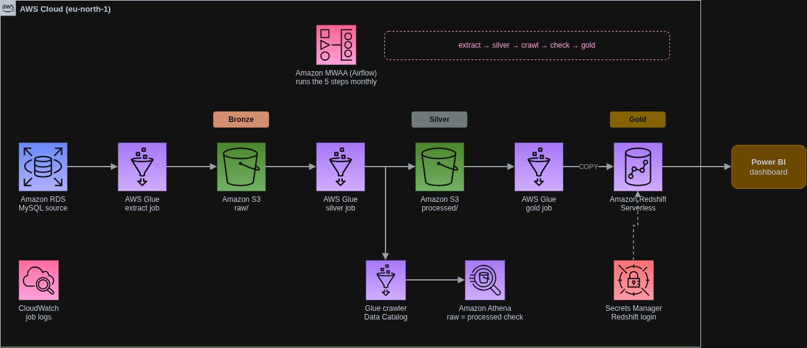
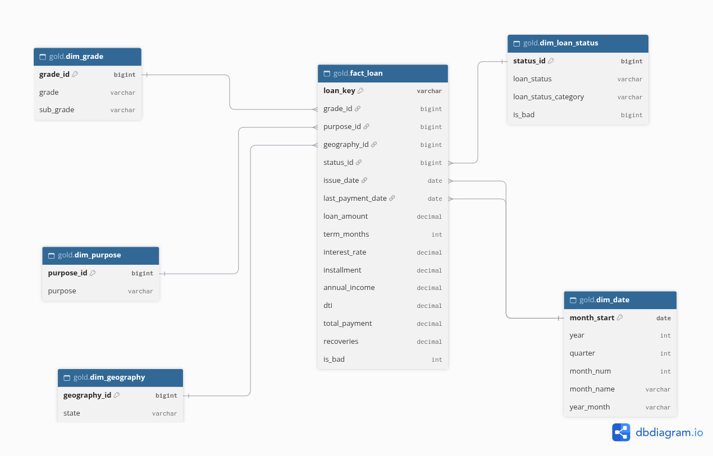
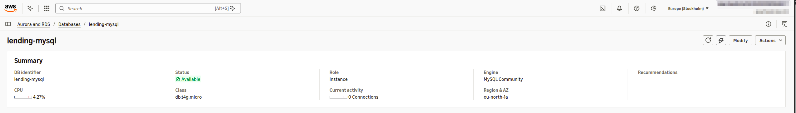
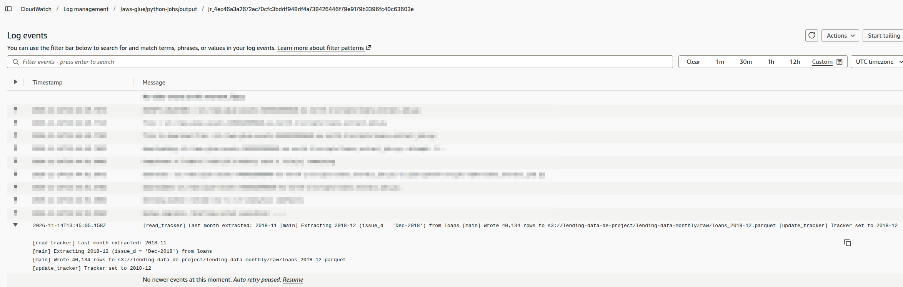
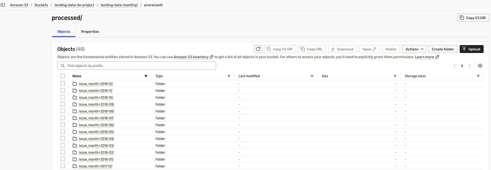
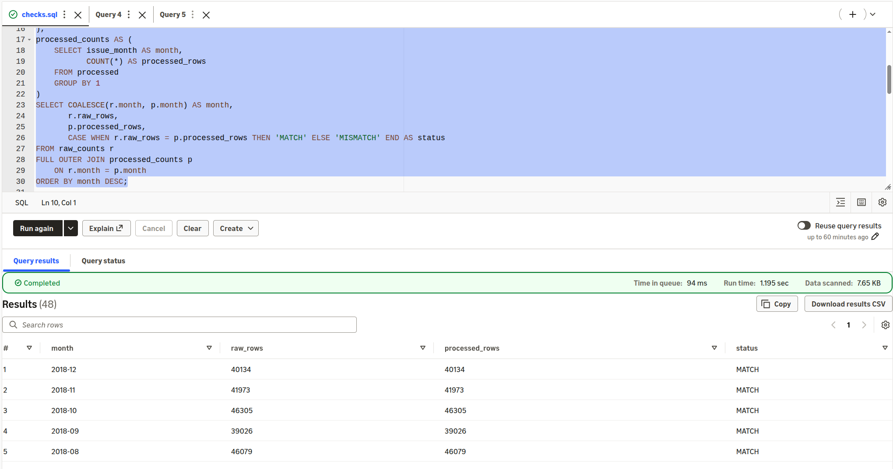
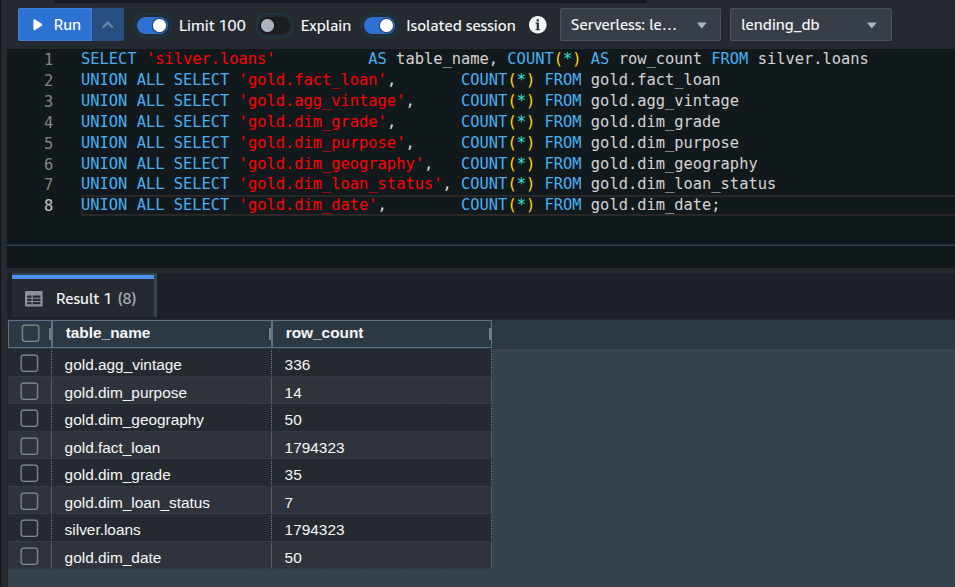
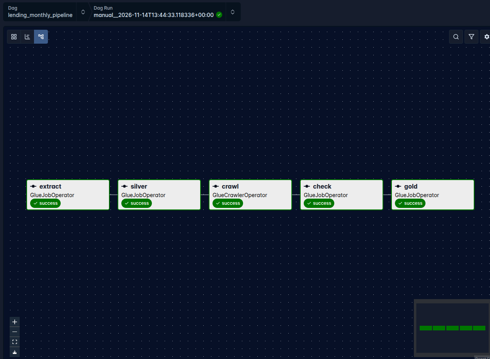

# Lending Club Loan Data Pipeline on AWS

## Objective

This project builds a monthly batch pipeline for consumer loan data on AWS. Each
month, new loans are pulled from the operational MySQL database, cleaned and
checked, and loaded into a Redshift star schema that a Power BI dashboard reads
for credit risk reporting (bad rates and vintage performance by grade).

The pipeline is **incremental**: each run loads only the new month, and every
stage can be re-run safely without duplicating data. It follows the **medallion
architecture** (Bronze, Silver, Gold) and is orchestrated by **Apache Airflow**.

## Table of Contents

- [Dataset Used](#dataset-used)
- [Technologies](#technologies)
- [Data Pipeline Architecture](#data-pipeline-architecture)
- [Medallion Layers](#medallion-layers)
- [Data Model](#data-model)
- [Step 1: Source database (RDS MySQL)](#step-1-source-database-rds-mysql)
- [Step 2: Ingestion (Glue extract)](#step-2-ingestion-glue-extract)
- [Step 3: Transformation (Silver)](#step-3-transformation-silver)
- [Step 4: Data checks (Athena)](#step-4-data-checks-athena)
- [Step 5: Warehouse (Redshift Gold)](#step-5-warehouse-redshift-gold)
- [Step 6: Orchestration (Airflow)](#step-6-orchestration-airflow)
- [Step 7: Dashboard (Power BI)](#step-7-dashboard-power-bi)
- [Repository Structure](#repository-structure)

## Dataset Used

Lending Club consumer loan data: one row per loan, with loan terms, borrower
profile, payments and the current loan status.

| | |
|---|---|
| Loans in the full file | 2,260,668 |
| Loans used (issued 2015-01 to 2018-12) | 1,794,323 |
| Months | 48 |
| Columns kept | 33 |

Source: [Lending Club Loan Data on Kaggle](https://www.kaggle.com/datasets/adarshsng/lending-club-loan-data-csv)

## Technologies

| Area | Service |
|---|---|
| Source database | Amazon RDS for MySQL |
| Extract and transform | AWS Glue (Python shell jobs, pandas, pyarrow) |
| Data lake | Amazon S3 (Parquet) |
| Catalog and lake checks | AWS Glue Data Catalog and crawler, Amazon Athena |
| Data warehouse | Amazon Redshift Serverless (Redshift Data API) |
| Orchestration | Apache Airflow (Amazon MWAA) |
| Security | IAM least-privilege roles, AWS Secrets Manager, private VPC access |
| Monitoring | Amazon CloudWatch Logs |
| Dashboard | Power BI |
| Languages | Python, SQL |

## Data Pipeline Architecture



1. **Extract:** a Glue job reads the next month from RDS MySQL and writes it to S3 `raw/`.
2. **Transform:** a Glue job cleans and validates the month and writes it to S3 `processed/`, one folder per month.
3. **Check:** a crawler registers the new month, and Athena confirms every month in `raw/` arrived in `processed/` with the same row count.
4. **Load:** a Glue job copies the month into Redshift and updates the Gold star schema in one transaction.
5. **Report:** Power BI reads the Gold tables.

Each job keeps a small tracker file in S3 (`_state/`) with the last month it
finished. A job only moves its tracker after the month succeeds, so a failed or
missed run is picked up automatically on the next run.

## Medallion Layers

| Layer | Where | What it holds |
|---|---|---|
| **Bronze** | S3 `raw/` | One Parquet file per month, exactly as in the source (all text) |
| **Silver** | S3 `processed/issue_month=YYYY-MM/` and Redshift `silver.loans` | Cleaned, typed and validated loans |
| **Gold** | Redshift `gold.*` | Star schema and summary table for reporting |

## Data Model



The Gold layer is a star schema with one fact table, `gold.fact_loan` (one row per
loan), and five dimensions: grade, purpose, geography, loan status and date. The
dimension IDs are IDENTITY columns, so existing IDs never change when new values
arrive. `gold.agg_vintage` is a summary table built from the fact table (one row
per issue month and grade) for the vintage report.

The diagram shows the keys and main measures. The full column lists are in
[`sql/redshift/`](sql/redshift/).

---

## Step 1: Source database (RDS MySQL)

The loan data is loaded into an Amazon RDS for MySQL database, which acts as the
operational system the pipeline reads from. Access is limited to the VPC and an
allow-listed admin IP.



Details: [`00_source_setup`](00_source_setup/)

---

## Step 2: Ingestion (Glue extract)

`loans_extract_job` connects to RDS through a Glue JDBC connection inside the VPC,
reads the next month after the one in its tracker, and writes it to S3 `raw/`.
If the source has no new month yet, it stops without writing anything.



Details: [`01_ingestion`](01_ingestion/)

---

## Step 3: Transformation (Silver)

`loans_silver_job` renames columns, converts dates and numbers, standardises text,
adds derived columns (risk category, `is_bad`, quality flags) and checks 7 rules
before writing each month to S3 `processed/`.



Details: [`02_transformation`](02_transformation/)

---

## Step 4: Data checks (Athena)

`lending_lake_crawler` registers the new month in the Glue Data Catalog. Then
`loans_lake_check_job` runs an Athena query that compares the row count of every
month in `raw/` and `processed/`. If any month is missing or different, the job
fails and nothing is loaded into the warehouse.



Details: [`02_transformation`](02_transformation/)

---

## Step 5: Warehouse (Redshift Gold)

`loans_gold_job` copies the new month into `silver.loans`, adds any new dimension
values, and replaces that month in `gold.fact_loan` and `gold.agg_vintage`. All 11
statements run in one transaction, then 4 checks confirm the counts match before
the tracker moves. Loading the same month twice gives the same result.



Details: [`03_warehouse`](03_warehouse/)

---

## Step 6: Orchestration (Airflow)

One Airflow DAG runs the five steps in order on the 1st of each month:
`extract → silver → crawl → check → gold`. Each step starts only after the
previous one succeeds. A full month runs end to end in about 5 minutes.



Details: [`04_orchestration`](04_orchestration/)

---

## Step 7: Dashboard (Power BI)

*In progress.* Power BI connects to the Gold tables in Redshift for credit risk
reporting: bad rate by grade, vintage performance by issue month, and loan
volumes by purpose and state.

---

## Repository Structure

```
00_source_setup/     Load the source data into RDS MySQL
01_ingestion/        Glue extract job: RDS to S3 raw
02_transformation/   Glue Silver job and Athena lake check
03_warehouse/        Glue Gold job: S3 processed to Redshift
04_orchestration/    Airflow DAG and Docker setup
sql/athena/          Athena check queries
sql/redshift/        Redshift table definitions (Silver and Gold)
images/              Architecture and data model diagrams
```